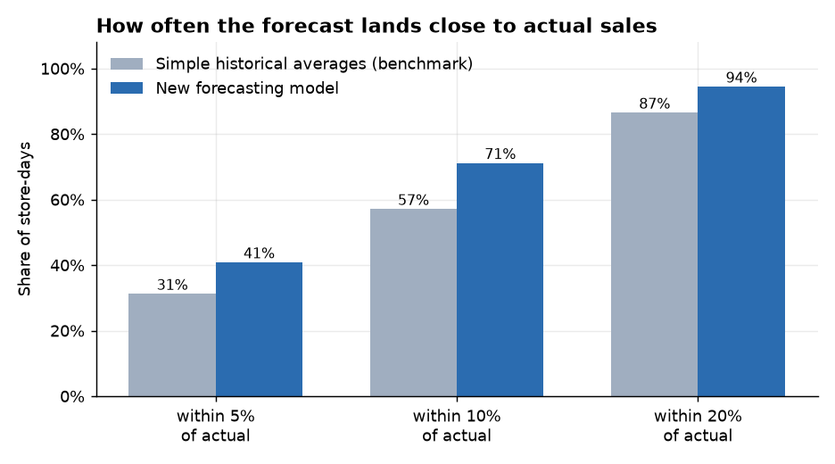
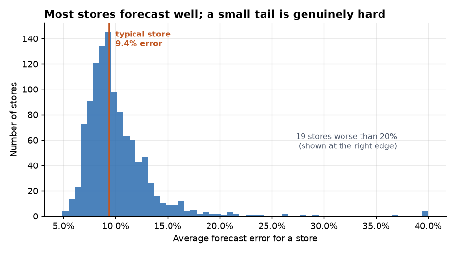
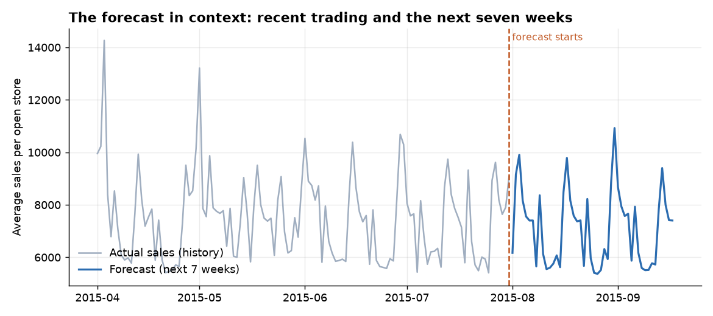
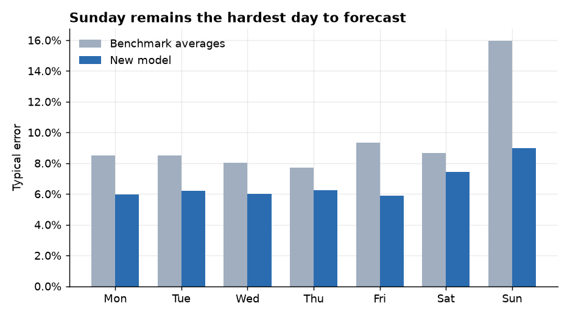

# Store Sales Forecasting — Summary for Stakeholders

**In one line:** we built a system that predicts daily sales for each of 1,115 stores up to
seven weeks ahead. For a typical store on a typical day it lands **within about 6% of actual
sales**, and it is right within 10% on **71% of store-days** — up from 57% using straightforward
historical averages.

This document is written for a non-technical reader. The engineering detail lives in
[README.md](README.md).

---

## What problem this solves

Store managers need to know how busy the next few weeks will be, to plan staffing and stock.
Today that judgement rests largely on experience and simple rules of thumb ("last year plus a
bit", "Mondays are busy"). Those rules work reasonably well on ordinary days and poorly around
promotions, holidays, and anything unusual — which are exactly the days where getting it wrong
is expensive.

The goal was a forecast that is accurate enough to plan against, and — just as important —
**honest about when it is likely to be wrong**.

## How accurate is it?

We tested the system the way it would actually be used: we hid the most recent six weeks of
sales, forecast them from scratch, and compared against what really happened. Nothing about
those six weeks influenced how the model was built.

Compared with a sensible benchmark built from historical averages, the model is meaningfully
better across the board. The clearest way to read this: **on roughly seven store-days in ten,
the forecast is within 10% of what actually happened.** The benchmark manages closer to six.

The model is also **unbiased** — it forecasts too high on 47% of days and too low on 53%. It is
not systematically optimistic or pessimistic, which matters if these numbers feed into
staffing budgets.

## Not every store is equally predictable

An average hides a lot. Some stores are very steady and forecast beautifully; a handful behave
erratically and are hard to predict no matter what we do.

The typical store has an average error around **9%**. But **19 stores out of 1,115** run worse
than 20%, and the very worst is far beyond that. This is the single most important operational
point in this document:

> **The error is highly concentrated. The worst 10% of store-days account for 59% of all
> forecast error.** Most of the time the forecast is good; occasionally it is badly wrong.

When we looked at what makes the worst cases bad, the answer was usually not a modelling
failure but a **change in the store itself**. The single worst store was open only 9 days in
July, against about 25 in the months before — a store winding down or being refurbished. No
forecast based on a store's own sales history can anticipate that. This is a data problem, not
an algorithm problem: if store status changes were fed into the system, these cases would
largely disappear.

## What the forecast looks like

The forecast continues the weekly rhythm and overall level of recent trading, which is what we
would want to see. The regular sawtooth is the weekly cycle — most stores close on Sundays.

## Where it is weaker

**Sunday is consistently the hardest day** (about 9% typical error, against roughly 6% on
weekdays). The reason is simple: only 33 of 1,115 stores ever open on a Sunday, so there is far
less history to learn from. Saturday is slightly harder than weekdays for related reasons.

Two other patterns worth knowing:

- **Accuracy decays with distance.** Week 1 of the forecast is noticeably better than week 3.
  The model works from a snapshot of recent trading, and that snapshot ages.
- **Promotion days are *easier*, not harder** — promotions are planned in advance, so the model
  knows they are coming and has seen many before.

## What it should and should not be used for

**Good uses**

- Planning staffing and stock at the store-week level, where day-to-day errors partly cancel out.
- Spotting stores whose trading is diverging from expectation.
- Comparing planned promotion calendars.

**Use with care**

- **Single-day, single-store commitments** — particularly for the small number of high-error
  stores. Any forecast shown to a planner should carry that store's historical accuracy
  alongside it, so a 6% store and a 30% store are not presented as equally trustworthy.
- **Stores undergoing change** (refurbishment, reduced hours, closure). The system has no way
  to know, and will keep forecasting as though nothing happened.
- **The forecast is a single number, not a range.** It does not currently express uncertainty,
  which is what staffing decisions really need.

## What would improve it next

In rough order of expected value for effort:

1. **Feed in store status.** Planned closures, refurbishments, and reduced hours would address
   the largest single source of severe errors.
2. **Re-forecast weekly rather than once per period.** Accuracy decays across the seven-week
   window; refreshing from current data recovers most of that and needs no modelling change.
3. **Publish a range, not a point.** Giving planners a realistic best/worst case is likely more
   valuable operationally than another increment of average accuracy.
4. **Fix a known technical defect.** We found, during final testing, that one group of
   calendar-related inputs behaves differently at the very end of the data than during
   training. It is documented, understood, and modest in size — but it is real, and it is the
   first thing an engineer should correct. We deliberately did not patch it at the last minute,
   because doing so would have meant tuning against the final test data and would have
   invalidated the accuracy figures in this document.

## A note on how this was built

Six rounds of work, each measured against the same hidden six weeks of sales. Worth knowing:
**the sophisticated techniques were not what made the difference.** A neural network — the most
advanced approach tried — performed exactly as well as a much simpler and faster method, and
was dropped from the final system.

The gains came instead from unglamorous engineering: making sure the model was trained on
information shaped exactly like what it gets in real use, handling store identity properly,
tuning settings that had been left at defaults, and correcting a systematic bias in how
predictions were scaled. That is a normal and worth-repeating pattern — **most of the value was
in getting the fundamentals right, not in the algorithm.**

Every decision was made without ever looking at the final test data, which is why the accuracy
figures here should hold up in practice rather than flattering the system.
